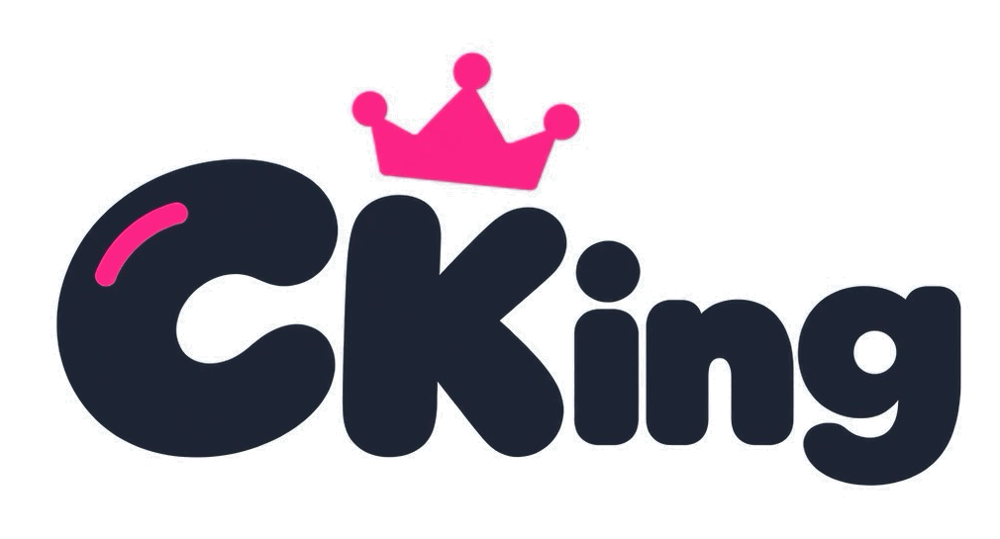
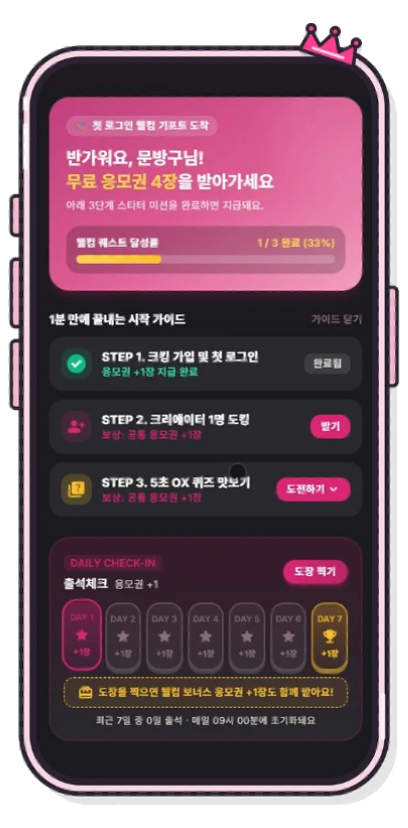
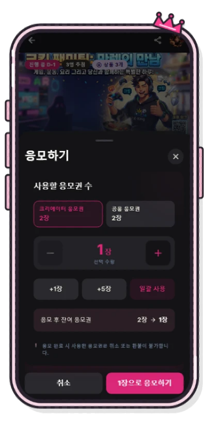
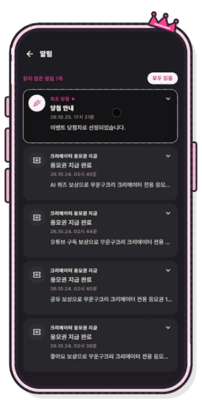
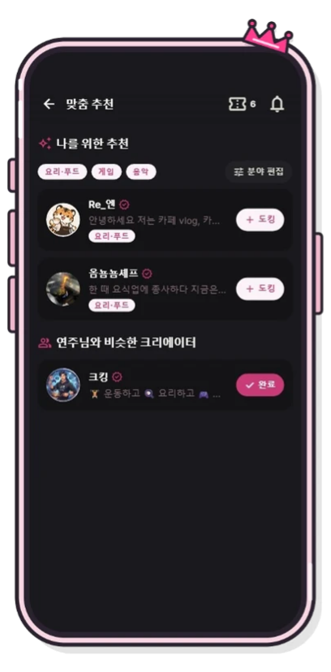
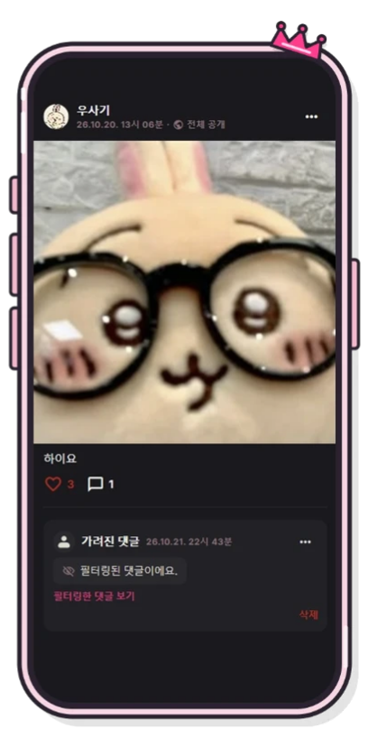
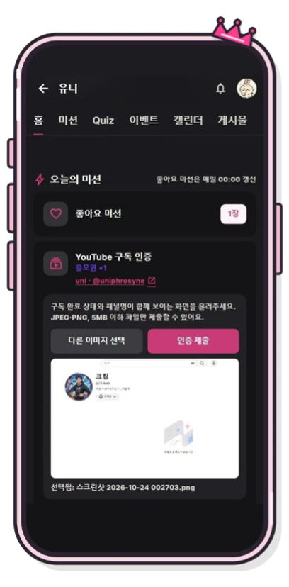
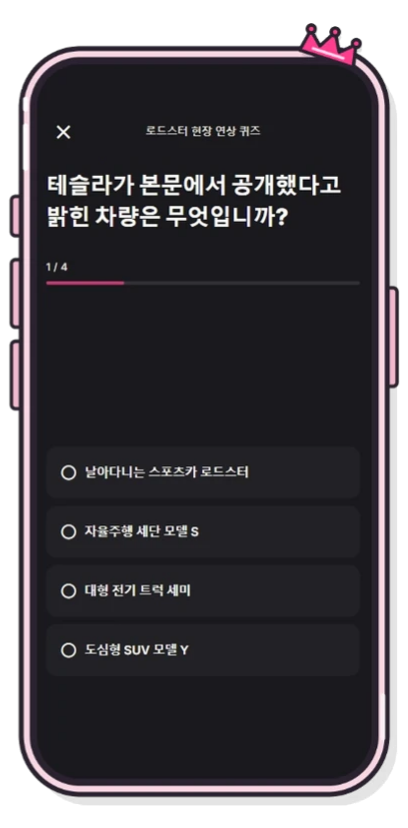

<div align="center">
  

  <h3>크리에이터와 팬을 연결하는 참여형 플랫폼, CKing</h3>

  <p>
    크리에이터 탐색과 도킹부터 콘텐츠·미션 참여, 응모권 획득, 이벤트 응모와 당첨 결과 확인까지.<br />
    CKing의 사용자·크리에이터 서비스와 관리자 콘솔을 구현한 프론트엔드 저장소입니다.
  </p>

  <p><a href="https://cking.co.kr"></a></p>
  <p><a href="https://github.com/URECA-Cking/Cking-BE"></a></p>
  <p><a href="https://github.com/URECA-Cking/Cking-Infra"></a></p>
  <p><a href="https://youtu.be/WEKKLaadHcM"></a></p>
  <p>서비스는 종료되었습니다. 시연은 DEMO 영상에서 볼 수 있습니다.</p>
</div>

<br />

## 주요 서비스 화면

서비스의 실제 UI 캡처를 기능별로 정리했습니다. 사용자·크리에이터 화면은 `apps/web`, 운영자 콘솔은 `apps/admin`에서 제공합니다.

### 핵심 서비스

|                  미⁠션⁠·⁠응⁠모⁠권                   |                  이⁠벤⁠트⁠ ⁠응⁠모                   |                당⁠첨⁠ ⁠결⁠과⁠·⁠알⁠림                |
| :---: | :---: | :---: |
|  |  |  |

### 크리에이터·AI 기능

|           맞⁠춤⁠ ⁠크⁠리⁠에⁠이⁠터⁠ ⁠추⁠천           |       C⁠r⁠e⁠a⁠t⁠o⁠r⁠ ⁠S⁠p⁠a⁠c⁠e⁠ ⁠·⁠ ⁠게⁠시⁠물       |       Y⁠o⁠u⁠T⁠u⁠b⁠e⁠ ⁠구⁠독⁠ ⁠인⁠증⁠ ⁠미⁠션        |                  A⁠I⁠ ⁠퀴⁠즈⁠ ⁠미⁠션                  |
| :---: | :---: | :---: | :---: |
|  |  |  |  |

<br />

## 기술 스택

| 분류 | 사용 기술 |
| :--- | :--- |
| Frontend |     |
| Architecture |     |
| Quality |    |
| Deploy |    |

<br />

## 프로젝트 구조

```text
CKing-FE/
├── apps/
│   ├── web/                       # 팬·크리에이터 서비스 (Vite)
│   │   ├── public/                # 정적 자산 · PWA manifest / service worker
│   │   └── src/
│   │       ├── api/               # 사용자·크리에이터 API 모듈
│   │       ├── components/        # 기능별 UI·레이아웃
│   │       ├── context/           # 세션 · 테마 · 토스트
│   │       ├── hooks/             # 비동기 조회 · 연결 상태
│   │       ├── pages/             # 홈 · 탐색 · 이벤트 · Creator Space
│   │       ├── pwa/               # PWA 설치·등록
│   │       └── utils/             # 상태 · 날짜 · 표시 유틸리티
│   └── admin/                     # 독립 관리자 서비스 (Vite)
│       └── src/
│           ├── api/               # 관리자 전용 API
│           ├── components/        # 관리자 공통 UI·레이아웃
│           └── pages/admin/       # 심사 · 운영 · 추첨 · 이상 행동
├── packages/shared/              # HTTP 전송 · 토큰 · 아이콘 · 공통 Hooks
├── docs/                         # FE 아키텍처 · API 연동 · 검증 문서
└── package.json                  # npm Workspaces 및 공통 스크립트
```

Web과 Admin은 각각 라우팅·인증 상태·도메인 코드를 소유하며, 실제 공통 로직만 `packages/shared`로 분리합니다. 자세한 구조는 [FE 아키텍처 문서](docs/architecture.md)를 참고하세요.

<br />

## 로컬 실행 및 개발 가이드

### 1. 사전 준비

Node.js 및 npm, 연동할 [CKing-BE](https://github.com/URECA-Cking/Cking-BE) 서버를 준비합니다.

### 2. 환경변수 설정

```bash
npm ci
cp apps/web/.env.example apps/web/.env
```

| 변수 | 설명 |
| :--- | :--- |
| `VITE_API_PROXY_TARGET` | 개발 서버가 `/api`를 전달할 BE 주소 (기본 `http://localhost:8080`) |
| `VITE_API_BASE_URL` | API 기준 주소. 비워두면 동일 출처 요청과 Vite 프록시 사용 |
| `VITE_ADMIN_BASE_URL` | Web에서 이동하는 관리자 콘솔 주소 (기본 `http://localhost:5174`) |

### 3. 개발 서버 실행

```bash
# 팬·크리에이터 Web — http://localhost:5173
npm run dev:web

# 관리자 콘솔 — http://localhost:5174 (다른 터미널)
npm run dev:admin
```

Google·Kakao OAuth 로그인은 페이지 이동 방식이므로 백엔드 OAuth 설정이 필요합니다. 로컬에서 UI만 확인하려면 Web 주소에 `?mock=1`(팬), `?mock=creator`(크리에이터), `?mock=empty`(빈 상태)를 붙일 수 있습니다. Mock API는 개발 모드에만 로드됩니다.

### 4. 검사 및 빌드

```bash
npm run lint
npm run test
npm run build
```

Web은 PWA를 지원하며, 서비스 워커 등록·설치 동작은 프로덕션 빌드에서만 확인할 수 있습니다. 자세한 검증·배포 절차는 [개발 문서](docs/README.md)와 [Admin 앱 문서](docs/apps/admin.md)를 참고하세요.
