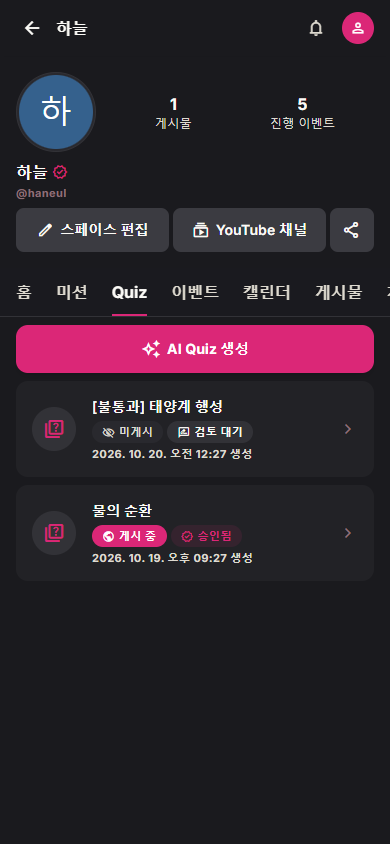
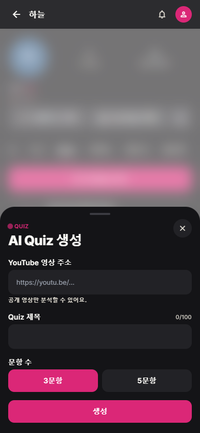
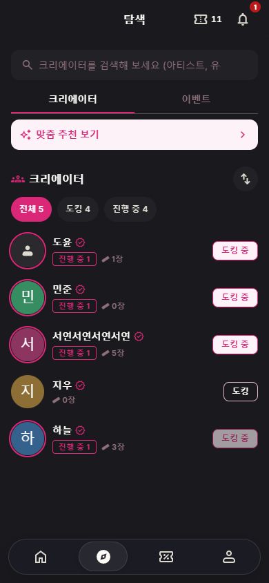
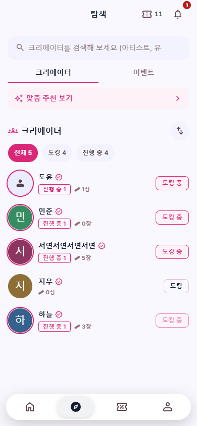
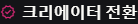

# Issue #264 화면 검증

- 기준: `task/264-creator-badge-quiz-terms`, 2026-10-20.
- Chrome headless, 모바일 390 × 844, Vite 개발 Mock(`?mock=creator`). 실제 BE 및 유료 AI Provider 호출은 수행하지 않았다.
- Creator Space의 기존 `verified` 채움 아이콘·primary 색상·모바일/데스크톱 크기를 공통 컴포넌트로 공유한다. 아이콘에는 `인증된 크리에이터` 접근성 이름을 제공한다.
- Creator Space, Creator 목록/카드, 마이페이지 Creator 전환에 공통 배지를 적용했다. 타 담당 화면에서는 배지와 관련 이름 행 배치만 변경했다.
- Quiz 생성 제목/버튼, 설명 삭제, 목록의 revision 미표시를 확인했다. Mock 생성 요청 후 성공 안내와 새 목록 항목을 확인하고, 해당 항목에서 revision 검토 영역으로 진입했다. 내부 revision 식별자·API 호출·승인/게시 로직은 유지한다.
- 수동 입력 콘텐츠(이벤트·게시글)는 작성, AI Quiz와 채널 설정에 따른 미션 생성은 생성으로 표현한다. 기존 일정 등록/수정 용어는 유지한다.

## 자동 검증

- `npm run lint`: 통과. 기존 `Notifications.jsx` 1건, `CreatorPosts.jsx` 2건의 경고가 남아 있다.
- `npm run build:web`: 통과.
- Web workspace에서 `node --test --test-concurrency=2 test/quizJobComponents.test.js test/quizContentReviewComponents.test.js test/eventPrizeKeysComponents.test.js test/quizJobs.test.js`: 79건 통과.
- 추가 `node --test --test-concurrency=2 test/quizJobs.test.js test/quizMock.test.js test/quizRevisionContentReview.test.js`: 34건 통과. 앞 실행의 quizJobs 테스트와 중복된다.
- `git diff --check`: 통과.
- 운영/개발 배포 환경의 실제 BE E2E와 유료 모델 생성은 미실행이다. 전체 테스트 스위트는 실행하지 않았다.
- 로컬 기본 npm 진입점이 사용자 전역 경로를 잘못 참조해, 설치된 Node의 `node_modules/npm/bin/npm-cli.js`로 npm 스크립트를 실행했다.

## 화면

### Creator Space 배지와 Quiz 목록

### AI Quiz 생성

### Creator 목록 — 다크 / 라이트

### 마이페이지 Creator 전환

